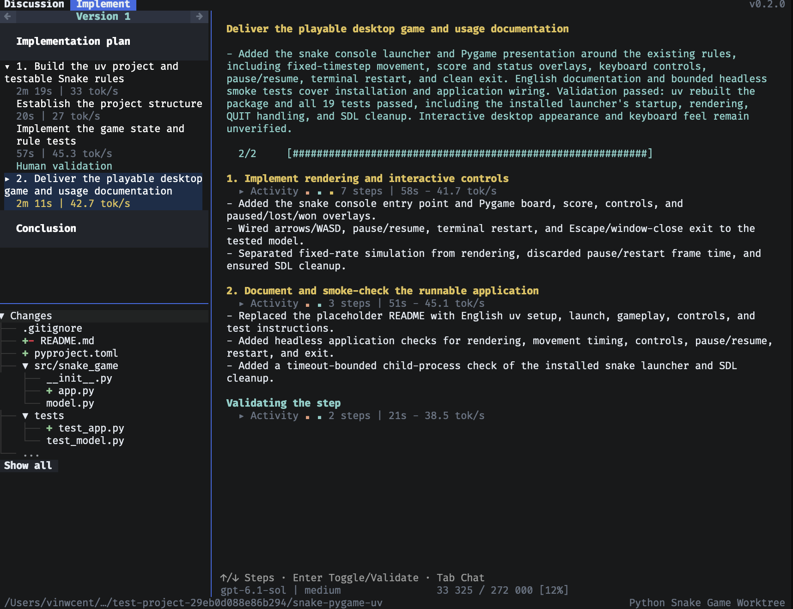
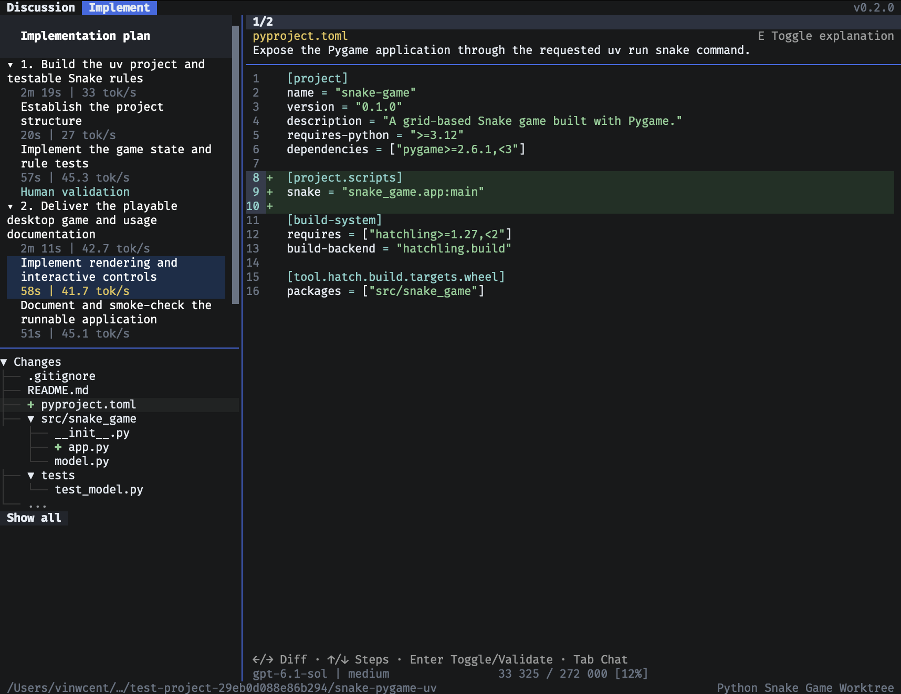

### Sloporsane (SOS)

<picture>
  <source media="(prefers-color-scheme: dark)" srcset="docs/images/sos-banner-dark.svg">
  <source media="(prefers-color-scheme: light)" srcset="docs/images/sos-banner-light.svg">
  
</picture>

An AI coding harness designed to make AI-generated code easier to understand.

```sh
curl -fsSL https://limpidd.com/install | bash
```

The official SOS website is [limpidd.com](https://www.limpidd.com/).

Available for **macOS 15+ (Apple Silicon)** and **Linux x86_64 (glibc 2.39+)**.

## How it works

SOS has two modes:

- **Slop** gives you the familiar chat-like experience: describe what you want and let the agent work.
- **Sane** breaks implementation into steps that make sense to a human, with explanations for each diff. You can read, approve, or challenge each step and work through changes before moving on.

<table>
  <tr>
    <td width="50%">
      <a href="docs/images/sane-implementation.png"></a>
    </td>
    <td width="50%">
      <a href="docs/images/sane-diff-review.png"></a>
    </td>
  </tr>
  <tr>
    <td align="center">Follow the implementation, step by step.</td>
    <td align="center">Read each diff and understand why it changed.</td>
  </tr>
</table>

## Who is it for

You can use SOS to vibe code, but the idea is to read the implementation, not skip it. It's for people who aren't comfortable shipping code without understanding what it does.

For building from source or contributing, see [CONTRIBUTING.md](CONTRIBUTING.md).

## License

SOS is released under the [MIT License](LICENSE).
