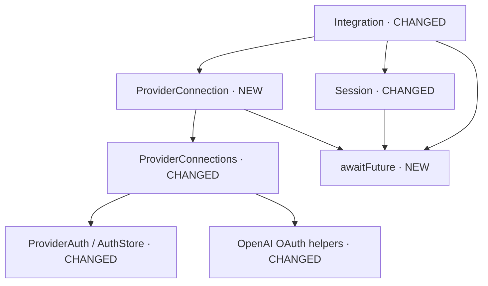

# Provider orchestration refactoring

> Historical design note for the refactoring, not a compatibility contract.
> Accepted formats are described in `daemon-protocol.md` and `mcp.md`;
> migration of older internal data is not guaranteed.

## Strategy

`Integration` should express session decisions and delegate connection details.
It should no longer know about tokens, the storage lock, the OpenAI callback or
OAuth futures. Title and catalog test callbacks remain injectable.



## Resulting interfaces

### Connection requests: new module `daemon/providers/provider_connection.hpp`

Commands are typed at the JSON boundary. The secret is no longer a general
attribute of the integration request.

```cpp
enum class ProviderCommand { LIST, API_KEY, START_OAUTH, POLL_OAUTH, CANCEL_OAUTH, SELECT };
struct ProviderRequest {
    ProviderCommand command;
    std::string provider;
    std::string model;
    std::string method;
    std::string key;
    std::string authId;
};
void from_json(const nlohmann::json& json, ProviderRequest& request);

class ProviderConnection {
public:
    explicit ProviderConnection(std::shared_ptr<ProviderConnections> providers);
    const ProviderSelection& selection() const;
    std::string defaultReasoning() const;
    void prepare(const ProviderRequest& request);
    asio::awaitable<nlohmann::json> handle(const ProviderRequest& request);
    void cancel();
    asio::awaitable<void> drain();
private:
    nlohmann::json listProviders() const;
    nlohmann::json saveApiKey(const ProviderRequest& request);
    asio::awaitable<nlohmann::json> startAuthentication(const ProviderRequest& request);
    nlohmann::json pollAuthentication(const std::string& id);
    asio::awaitable<nlohmann::json> cancelAuthentication(const std::string& id);
    nlohmann::json selectProvider(const ProviderSelection& selection);
    void requireNoPendingAuthentication() const;
    bool matches(const std::string& id) const;

    std::shared_ptr<ProviderConnections> providers;
    ProviderSelection selected;
    std::unique_ptr<ProviderAuthFlow> flow;
    std::shared_ptr<std::atomic<bool>> cancellation;
    std::string authProvider;
    std::string authId;
    std::uint64_t authNumber = 0;
};
```

### `ProviderConnections`: changed class

Files: `daemon/providers/provider_connections.hpp/.cpp`. Storage and its lock
become private; callers express only the desired operation.

```cpp
struct ProviderDescriptor { // ADDED
    std::string id;
    bool connected;
    std::string model;
};
class ProviderConnections {
public:
    using OAuthStarter = std::function<std::unique_ptr<ProviderAuthFlow>(const std::string&,
        std::shared_ptr<std::atomic<bool>>)>; // ADDED: testable flows without external services
    explicit ProviderConnections(std::shared_ptr<AuthStore> auth = std::make_shared<AuthStore>(),
        std::filesystem::path config = PathResolution::configFile(), OAuthStarter oauthStarter = {}); // ADDED
    ProviderSelection selection() const;
    std::string defaultReasoning(const ProviderSelection& selection) const;
    void select(const ProviderSelection& selection);
    std::unique_ptr<Provider> create(const std::string& provider) const;
    bool hasAuth(const std::string& provider) const; // ADDED
    void requireAuth(const std::string& provider) const; // ADDED
    std::vector<ProviderDescriptor> list(const ProviderSelection& selection) const; // ADDED
    void saveApiKey(const std::string& provider, const std::string& key); // ADDED
    void saveOAuth(const std::string& provider, const ProviderCredential& credential); // ADDED
    std::unique_ptr<ProviderAuthFlow> startOAuth(const std::string& provider,
        const std::string& method, std::shared_ptr<std::atomic<bool>> cancelled) const; // ADDED
private:
    void saveCredential(const std::string& provider, const ProviderCredential& credential); // ADDED
    std::shared_ptr<AuthStore> auth; // Moved from public
    std::filesystem::path config;
    OAuthStarter oauthStarter; // ADDED
};
```

### `Integration`: changed class

Files: `daemon/integration/integration.hpp/.cpp`. Reading signals cancellation
immediately; the loop remains the socket's sole writer. Session helpers explicitly
name saving, detachment and reset.

```cpp
class Integration : public std::enable_shared_from_this<Integration> {
public:
    using ReasoningEffortsLoader = std::function<std::vector<std::string>(const std::string& model)>;
    Integration(asio::io_context& io, ConnectionSocket connection, SessionRegistry& registry,
        SessionTitleGenerator titleGenerator, ReasoningEffortsLoader reasoningEffortsLoader = {},
        IntegrationHealthSettings health = {}, std::shared_ptr<ProviderConnections> providers = {});
    asio::awaitable<void> run();
    void close();
private:
    struct Disconnected {};
    struct Ping {};
    using Event = std::variant<IntegrationRequest, AgentEvent, PermissionEvent, Disconnected, Ping>;
    asio::awaitable<void> readRequests();
    asio::awaitable<nlohmann::json> handle(const IntegrationRequest& request);
    void subscribe();
    void schedulePing();
    void startReader(); // ADDED
    void prepareRequest(IntegrationRequest& request); // ADDED
    void acknowledgePong(const std::string& id); // ADDED
    nlohmann::json makePing(); // ADDED
    nlohmann::json runtimeInfo() const; // ADDED
    asio::awaitable<nlohmann::json> dispatch(Event& event); // ADDED
    asio::awaitable<nlohmann::json> handleRequest(const IntegrationRequest& request); // ADDED
    asio::awaitable<nlohmann::json> recordAgentEvent(const AgentEvent& event); // ADDED
    asio::awaitable<void> sendReply(nlohmann::json reply); // ADDED
    asio::awaitable<nlohmann::json> handleProvider(const IntegrationRequest& request); // ADDED
    nlohmann::json handlePermissions(const IntegrationRequest& request); // ADDED
    nlohmann::json newSession(const IntegrationRequest& request); // ADDED
    nlohmann::json attachSession(const IntegrationRequest& request); // ADDED
    asio::awaitable<nlohmann::json> nextReasoningEffort(const IntegrationRequest& request); // ADDED
    asio::awaitable<nlohmann::json> sendMessage(const IntegrationRequest& request); // ADDED
    SessionInfo makeSessionInfo(const IntegrationRequest& request); // ADDED
    asio::awaitable<bool> createSession(SessionInfo info, const std::string& text); // ADDED
    asio::awaitable<std::optional<std::string>> generateTitle(const SessionInfo& info, const std::string& text); // ADDED
    nlohmann::json cancelledReply(const IntegrationRequest& request, const SessionInfo& info,
        std::chrono::steady_clock::time_point startedAt) const; // ADDED
    bool consumePreparationCancellation(); // ADDED
    void requireIdleSession() const; // ADDED
    void saveSession(); // ADDED
    void detachSession(); // ADDED
    void resetConversationDefaults(); // ADDED

    asio::io_context& io;
    ConnectionSocket connection;
    SessionRegistry& registry;
    SessionTitleGenerator titleGenerator;
    ReasoningEffortsLoader reasoningEffortsLoader;
    std::string nextReasoning = daemon_config::DEFAULT_REASONING_EFFORT;
    std::shared_ptr<Session> session;
    std::shared_ptr<AsyncQueue<Event>> events;
    std::shared_ptr<PermissionManager> permissions;
    std::shared_ptr<std::atomic<bool>> preparingCancellation;
    IntegrationHealthSettings health;
    asio::steady_timer healthTimer;
    std::uint64_t pingNumber = 0;
    std::string expectedPong;
    bool closing = false;
    std::shared_ptr<ProviderConnections> providers;
    ProviderConnection providerConnection; // ADDED: replaces scattered OAuth state and selection
};
```

### `OpenAIProvider`: changed class

Files: `agent-runtime/providers/openai_provider.hpp/.cpp`. Transport stages are
named; `generate()` no longer contains their implementation.

```cpp
class OpenAIProvider : public Provider {
public:
    explicit OpenAIProvider(std::shared_ptr<ProviderAuth> auth,
        std::string apiEndpoint = "https://api.openai.com/v1/responses",
        std::string codexEndpoint = "https://chatgpt.com/backend-api/codex/responses");
    ProviderFormat getFormat() const override;
    nlohmann::json generate(const nlohmann::json& input, const std::string& model,
        const std::vector<ToolDefinition>& tools = {}, const std::string& reasoningEffort = "medium") override;
    std::vector<std::string> getReasoningEfforts(const std::string& model) override;
    std::optional<std::uint64_t> getUsedContext(const nlohmann::json& response) const override;
private:
    nlohmann::json prepareRequest(const nlohmann::json& input, const std::string& model,
        const std::vector<ToolDefinition>& tools, const std::string& reasoningEffort, bool codex); // ADDED
    std::string postRequest(const nlohmann::json& request, const ProviderAuthorization& authorization) const; // ADDED
    static void prepareCodexInstructions(nlohmann::json& request); // ADDED
    static nlohmann::json readResponse(const std::string& output, bool codex); // ADDED
    std::shared_ptr<ProviderAuth> auth;
    std::string apiEndpoint;
    std::string codexEndpoint;
};
```

### Internal modules

- `transport/await_future.hpp`: `template<class Future> asio::awaitable<void> awaitFuture(Future& future)`;
  shared nonblocking waiting, without consuming the result or abandoning the worker.
- `openai_oauth.cpp`: separate browser/device startup, local listening, HTTP
  reading, callback validation, waiting for the device code, and code exchange.
  Public functions remain stable; the result type becomes `ProviderAuthFlow`.
- `OpenAIProvider`: separate request preparation, Codex instructions, HTTP transport
  and response reading; `generate()` becomes their orchestration.

## Implementation order and validation

1. Extract future waiting and typed connection commands.
2. Encapsulate credentials in `ProviderConnections`; move the flow to `ProviderConnection`.
3. Break `Integration` into readable orchestration, preserving save/notification
   ordering and immediate cancellation.
4. Split long OAuth and OpenAI transport functions by intent.
5. Test API/OAuth, cancellation before startup and during waiting, failed selection,
   resume and refresh; run CTest, TUI tests and packaging only under `build-ai/`.

The main risk is worker lifetime: cancellation does not mean destroying a future
that is still running. Shutdown must await termination without blocking the Asio
loop. Tests use no real credentials.
