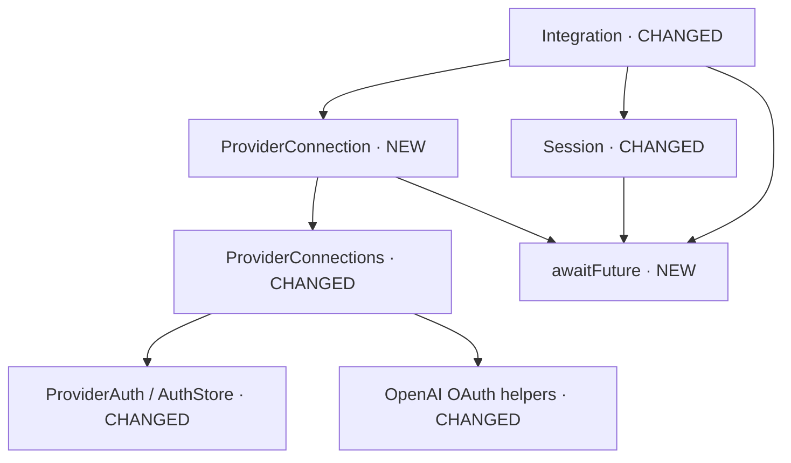

# Refactoring de l'orchestration des providers

> Note de conception historique du refactoring, pas un contrat de compatibilité.
> Les formats effectivement acceptés sont décrits dans `daemon-protocol.md` et
> `mcp.md` ; aucune migration des anciennes données internes n'est garantie.

## Stratégie

`Integration` doit exprimer les décisions de session et déléguer les détails de
connexion. Elle ne doit plus connaître les tokens, le verrou du stockage, le
callback OpenAI ou les futures OAuth. Les callbacks de test du titre et du catalogue
restent injectables.



## Interfaces résultantes

### Requêtes de connexion — nouveau module `daemon/providers/provider_connection.hpp`

Les commandes sont typées dès la frontière JSON. Le secret n'existe plus comme
attribut général de la requête d'intégration.

```cpp
enum class ProviderCommand { LIST, API_KEY, START_OAUTH, POLL_OAUTH, CANCEL_OAUTH, SELECT };
struct ProviderRequest {
    ProviderCommand command;
    std::string provider;
    std::string model;
    std::string method;
    std::string key;
    std::string authId;
};
void from_json(const nlohmann::json& json, ProviderRequest& request);

class ProviderConnection {
public:
    explicit ProviderConnection(std::shared_ptr<ProviderConnections> providers);
    const ProviderSelection& selection() const;
    std::string defaultReasoning() const;
    void prepare(const ProviderRequest& request);
    asio::awaitable<nlohmann::json> handle(const ProviderRequest& request);
    void cancel();
    asio::awaitable<void> drain();
private:
    nlohmann::json listProviders() const;
    nlohmann::json saveApiKey(const ProviderRequest& request);
    asio::awaitable<nlohmann::json> startAuthentication(const ProviderRequest& request);
    nlohmann::json pollAuthentication(const std::string& id);
    asio::awaitable<nlohmann::json> cancelAuthentication(const std::string& id);
    nlohmann::json selectProvider(const ProviderSelection& selection);
    void requireNoPendingAuthentication() const;
    bool matches(const std::string& id) const;

    std::shared_ptr<ProviderConnections> providers;
    ProviderSelection selected;
    std::unique_ptr<ProviderAuthFlow> flow;
    std::shared_ptr<std::atomic<bool>> cancellation;
    std::string authProvider;
    std::string authId;
    std::uint64_t authNumber = 0;
};
```

### `ProviderConnections` — classe modifiée

Fichiers : `daemon/providers/provider_connections.hpp/.cpp`. Le stockage et son
verrou deviennent privés ; les appelants expriment seulement l'opération souhaitée.

```cpp
struct ProviderDescriptor { // AJOUT
    std::string id;
    bool connected;
    std::string model;
};
class ProviderConnections {
public:
    using OAuthStarter = std::function<std::unique_ptr<ProviderAuthFlow>(const std::string&,
        std::shared_ptr<std::atomic<bool>>)>; // AJOUT : parcours testables sans service externe
    explicit ProviderConnections(std::shared_ptr<AuthStore> auth = std::make_shared<AuthStore>(),
        std::filesystem::path config = PathResolution::configFile(), OAuthStarter oauthStarter = {}); // AJOUT
    ProviderSelection selection() const;
    std::string defaultReasoning(const ProviderSelection& selection) const;
    void select(const ProviderSelection& selection);
    std::unique_ptr<Provider> create(const std::string& provider) const;
    bool hasAuth(const std::string& provider) const; // AJOUT
    void requireAuth(const std::string& provider) const; // AJOUT
    std::vector<ProviderDescriptor> list(const ProviderSelection& selection) const; // AJOUT
    void saveApiKey(const std::string& provider, const std::string& key); // AJOUT
    void saveOAuth(const std::string& provider, const ProviderCredential& credential); // AJOUT
    std::unique_ptr<ProviderAuthFlow> startOAuth(const std::string& provider,
        const std::string& method, std::shared_ptr<std::atomic<bool>> cancelled) const; // AJOUT
private:
    void saveCredential(const std::string& provider, const ProviderCredential& credential); // AJOUT
    std::shared_ptr<AuthStore> auth; // déplacé depuis public
    std::filesystem::path config;
    OAuthStarter oauthStarter; // AJOUT
};
```

### `Integration` — classe modifiée

Fichiers : `daemon/integration/integration.hpp/.cpp`. La lecture signale immédiatement
les annulations, la boucle reste l'unique écrivain du socket. Les helpers de session
nomment explicitement sauvegarde, détachement et remise à zéro.

```cpp
class Integration : public std::enable_shared_from_this<Integration> {
public:
    using ReasoningEffortsLoader = std::function<std::vector<std::string>(const std::string& model)>;
    Integration(asio::io_context& io, ConnectionSocket connection, SessionRegistry& registry,
        SessionTitleGenerator titleGenerator, ReasoningEffortsLoader reasoningEffortsLoader = {},
        IntegrationHealthSettings health = {}, std::shared_ptr<ProviderConnections> providers = {});
    asio::awaitable<void> run();
    void close();
private:
    struct Disconnected {};
    struct Ping {};
    using Event = std::variant<IntegrationRequest, AgentEvent, PermissionEvent, Disconnected, Ping>;
    asio::awaitable<void> readRequests();
    asio::awaitable<nlohmann::json> handle(const IntegrationRequest& request);
    void subscribe();
    void schedulePing();
    void startReader(); // AJOUT
    void prepareRequest(IntegrationRequest& request); // AJOUT
    void acknowledgePong(const std::string& id); // AJOUT
    nlohmann::json makePing(); // AJOUT
    nlohmann::json runtimeInfo() const; // AJOUT
    asio::awaitable<nlohmann::json> dispatch(Event& event); // AJOUT
    asio::awaitable<nlohmann::json> handleRequest(const IntegrationRequest& request); // AJOUT
    asio::awaitable<nlohmann::json> recordAgentEvent(const AgentEvent& event); // AJOUT
    asio::awaitable<void> sendReply(nlohmann::json reply); // AJOUT
    asio::awaitable<nlohmann::json> handleProvider(const IntegrationRequest& request); // AJOUT
    nlohmann::json handlePermissions(const IntegrationRequest& request); // AJOUT
    nlohmann::json newSession(const IntegrationRequest& request); // AJOUT
    nlohmann::json attachSession(const IntegrationRequest& request); // AJOUT
    asio::awaitable<nlohmann::json> nextReasoningEffort(const IntegrationRequest& request); // AJOUT
    asio::awaitable<nlohmann::json> sendMessage(const IntegrationRequest& request); // AJOUT
    SessionInfo makeSessionInfo(const IntegrationRequest& request); // AJOUT
    asio::awaitable<bool> createSession(SessionInfo info, const std::string& text); // AJOUT
    asio::awaitable<std::optional<std::string>> generateTitle(const SessionInfo& info, const std::string& text); // AJOUT
    nlohmann::json cancelledReply(const IntegrationRequest& request, const SessionInfo& info,
        std::chrono::steady_clock::time_point startedAt) const; // AJOUT
    bool consumePreparationCancellation(); // AJOUT
    void requireIdleSession() const; // AJOUT
    void saveSession(); // AJOUT
    void detachSession(); // AJOUT
    void resetConversationDefaults(); // AJOUT

    asio::io_context& io;
    ConnectionSocket connection;
    SessionRegistry& registry;
    SessionTitleGenerator titleGenerator;
    ReasoningEffortsLoader reasoningEffortsLoader;
    std::string nextReasoning = daemon_config::DEFAULT_REASONING_EFFORT;
    std::shared_ptr<Session> session;
    std::shared_ptr<AsyncQueue<Event>> events;
    std::shared_ptr<PermissionManager> permissions;
    std::shared_ptr<std::atomic<bool>> preparingCancellation;
    IntegrationHealthSettings health;
    asio::steady_timer healthTimer;
    std::uint64_t pingNumber = 0;
    std::string expectedPong;
    bool closing = false;
    std::shared_ptr<ProviderConnections> providers;
    ProviderConnection providerConnection; // AJOUT, remplace l'état OAuth et la sélection dispersés
};
```

### `OpenAIProvider` — classe modifiée

Fichiers : `agent-runtime/providers/openai_provider.hpp/.cpp`. Les étapes du
transport sont nommées ; `generate()` ne déroule plus leur implémentation.

```cpp
class OpenAIProvider : public Provider {
public:
    explicit OpenAIProvider(std::shared_ptr<ProviderAuth> auth,
        std::string apiEndpoint = "https://api.openai.com/v1/responses",
        std::string codexEndpoint = "https://chatgpt.com/backend-api/codex/responses");
    ProviderFormat getFormat() const override;
    nlohmann::json generate(const nlohmann::json& input, const std::string& model,
        const std::vector<ToolDefinition>& tools = {}, const std::string& reasoningEffort = "medium") override;
    std::vector<std::string> getReasoningEfforts(const std::string& model) override;
    std::optional<std::uint64_t> getUsedContext(const nlohmann::json& response) const override;
private:
    nlohmann::json prepareRequest(const nlohmann::json& input, const std::string& model,
        const std::vector<ToolDefinition>& tools, const std::string& reasoningEffort, bool codex); // AJOUT
    std::string postRequest(const nlohmann::json& request, const ProviderAuthorization& authorization) const; // AJOUT
    static void prepareCodexInstructions(nlohmann::json& request); // AJOUT
    static nlohmann::json readResponse(const std::string& output, bool codex); // AJOUT
    std::shared_ptr<ProviderAuth> auth;
    std::string apiEndpoint;
    std::string codexEndpoint;
};
```

### Modules internes

- `transport/await_future.hpp` : `template<class Future> asio::awaitable<void> awaitFuture(Future& future)` ; attente non bloquante commune, sans consommer le résultat ni abandonner le worker.
- `openai_oauth.cpp` : séparer démarrage navigateur/appareil, écoute locale, lecture HTTP, validation du callback, attente du code appareil, puis échange du code. Les fonctions publiques restent stables ; le type de résultat devient `ProviderAuthFlow`.
- `OpenAIProvider` : séparer préparation de la requête, instructions Codex, transport HTTP et lecture de la réponse ; `generate()` devient l'enchaînement de ces opérations.

## Ordre de réalisation et validation

1. Extraire l'attente des futures et les commandes de connexion typées.
2. Encapsuler les credentials dans `ProviderConnections`, déplacer le parcours vers `ProviderConnection`.
3. Décomposer `Integration` en orchestration lisible, en conservant l'ordre sauvegarde/notification et l'annulation immédiate.
4. Décomposer les longues fonctions OAuth et du transport OpenAI par intention.
5. Tester API/OAuth, annulation avant démarrage et pendant attente, sélection échouée, reprise et renouvellement ; exécuter CTest, les tests TUI et le packaging exclusivement sous `build-ai/`.

Le risque principal est la durée de vie des workers : annuler ne signifie pas
détruire une future encore en cours. La fermeture doit attendre leur terminaison
sans bloquer la boucle Asio. Les tests n'utilisent aucun credential réel.
